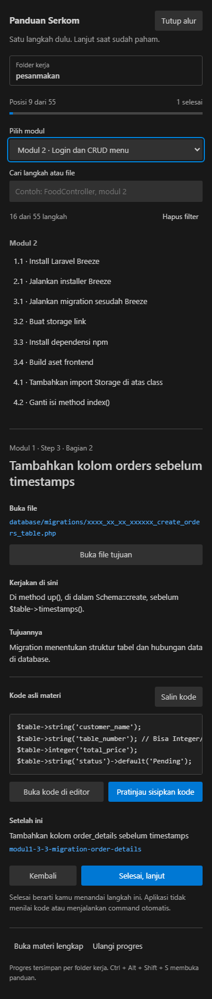
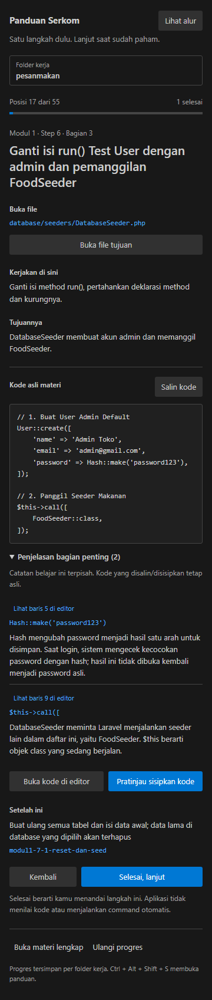

# Panduan Serkom

Pendamping belajar Laravel di dalam Visual Studio Code. Ikuti 55 langkah dari persiapan sampai database, login, CRUD menu, pemesanan pelanggan, dashboard, dan route.

Setiap langkah menunjukkan **file tujuan → lokasi kode → tujuan langkah → kode asli → langkah berikutnya**. Progres disimpan per folder proyek dalam workspace VS Code yang digunakan.

## Instalasi di Visual Studio Code

Tidak perlu mengunduh source, menjalankan npm, atau login GitHub untuk memakai ekstensi.

1. Buka [rilis terbaru](https://github.com/lordbarry21/panduan-serkom/releases/latest).
2. Pada bagian **Assets**, unduh file **panduan-serkom-1.1.0.vsix**.
3. Buka **Visual Studio Code** versi **1.96 atau lebih baru**.
4. Tekan **Ctrl+Shift+P**, cari **Extensions: Install from VSIX…**.
5. Pilih file `.vsix` yang diunduh, lalu tunggu pemasangan selesai. VS Code mungkin meminta konfirmasi kepercayaan terhadap publisher lokal.
6. Tekan **Ctrl+Alt+Shift+S**, atau cari **Serkom: Buka Panduan** di Command Palette.
7. Jika perintah belum muncul, jalankan **Developer: Reload Window**.

Alternatif lewat terminal:

```powershell
code --install-extension .\panduan-serkom-1.1.0.vsix
```

Ini ekstensi untuk **VS Code**, bukan Visual Studio. Paket ini didistribusikan melalui GitHub Releases dan belum diterbitkan di Visual Studio Marketplace.

## Memasang dari USB ke device lain

1. Salin file `.vsix` ke USB. Unduh juga `PASANG-PANDUAN.cmd` dari rilis jika ingin memakai pemasang Windows.
2. Letakkan `.cmd` dan `.vsix` versi yang sama di satu folder.
3. Di PC tujuan, klik dua kali **PASANG-PANDUAN.cmd**. VS Code harus sudah terpasang.
4. Jika command VS Code tidak ditemukan, gunakan **Install from VSIX** seperti langkah di atas.
5. Buka panduan dan pilih folder proyek pada PC itu.

Seluruh materi sudah dibundel, sehingga ekstensi berjalan lokal tanpa API key, server tambahan, atau internet setelah pemasangan. Laravel, PHP, Composer, MySQL, dan dependensi proyek latihan tetap disiapkan sendiri. Progres belajar tidak disinkronkan antar-PC; paket lokal dapat dipasang ulang melalui VSIX.

## Mulai mengerjakan

1. Klik **Folder kerja** dan pilih folder Laravel yang berisi `artisan`.
2. Jika membuat proyek dari awal, pilih folder induk dahulu. Setelah `create-project` selesai, pilih ulang folder `pesanmakan` sebagai folder kerja.
3. Buka **Lihat alur**, lalu pilih langkah yang sedang dikerjakan. Langkah yang sudah dikerjakan boleh dilewati secara manual.
4. Baca **Buka file**, **Kerjakan di sini**, dan **Tujuannya**.
5. Tekan **Buka file tujuan**. Migration bertanggal dicari dari nama tabel; jika ada beberapa, pilih file yang sesuai.
6. Ketik sendiri sambil membaca kode, atau gunakan **Salin kode**. **Buka kode di editor** menampilkan salinan hanya-baca.
7. Untuk bantuan penyisipan, pilih **Pratinjau sisipkan kode**. Bandingkan sebelum/sesudah; jika sesuai, klik **Terapkan perubahan**, lalu **Ctrl+S**. **Ctrl+Z** membatalkan edit.
8. Klik **Selesai, lanjut** setelah mengerjakan langkahnya.

Untuk route dan penyamaan model, seleksi sendiri blok lama yang hendak diganti sebelum membuka pratinjau. Untuk penambahan di lokasi pilihanmu sendiri, salin kode dan tempel langsung. Ekstensi menolak penempatan otomatis ketika struktur file tidak jelas atau method/properti yang sama sudah ada.

Pada langkah terminal, tekan **Salin command**, buka terminal proyek, lalu tempel dan jalankan sendiri. **Buka terminal proyek** tidak menjalankan command otomatis.

## Filter modul di Lihat alur

Dropdown **Pilih modul** membatasi daftar ke modul yang dipilih. Pencarian bekerja bersamaan dengan filter: pilih Modul 2 lalu cari `FoodController`, misalnya.

| Pilihan | Materi | Jumlah langkah |
| --- | --- | ---: |
| Semua modul | Seluruh alur | 55 |
| Persiapan | Buat dan buka proyek | 3 |
| Modul 1 | Database, migration, seeder, model | 24 |
| Modul 2 | Login dan CRUD menu | 16 |
| Modul 3 | Pemesanan pelanggan | 7 |
| Modul 4 | Dashboard dan route | 5 |

Pilihan modul dan kata pencarian tetap tersimpan saat panel dimuat ulang. **Hapus filter** mengembalikan seluruh alur. Filter hanya mengatur daftar; **Selesai, lanjut** tetap mengikuti urutan materi lengkap, termasuk menyeberang ke modul berikutnya.



## Penjelasan kode yang sulit

Pada langkah terkait, bagian **Penjelasan bagian penting** menerangkan istilah yang sering membingungkan pemula. Penjelasan dipilih untuk 34 langkah; baris yang sederhana tidak diberi komentar berulang. Contohnya `Hash::make`, trait, foreign key, `cascade`, validasi, transaksi database, relasi, dan direktif Blade.

Setiap catatan menampilkan potongan kode dengan format inline dan tombol **Lihat baris … di editor**. Tombol itu membuka kode asli pada baris yang diterangkan. Bagian penjelasan dapat dilipat lewat judulnya.

Misalnya, `Hash::make('password123')` dijelaskan sebagai pembuatan hash password satu arah untuk penyimpanan; pencocokan login memakai pemeriksaan hash, bukan mengembalikan hash menjadi password. Lihat [dokumentasi Hashing Laravel](https://laravel.com/docs/12.x/hashing).

Catatan berada dalam [`data/notes.json`](data/notes.json), terpisah dari kode latihan. **Salin kode**, pratinjau, dan penerapan edit tetap memakai kode sumber asli tanpa menambahkan penjelasan ke file proyek.



## Progres dan shortcut

- **Ctrl+Alt+Shift+S**: buka panduan; gunakan **Cmd+Alt+Shift+S** di macOS.
- **Kembali**: lihat langkah sebelumnya tanpa menghapus tanda selesai.
- **Tandai belum selesai**: hapus tanda selesai pada langkah saat ini.
- **Ulangi progres**: mulai penanda belajar dari awal, dengan konfirmasi; file proyek tidak diubah.

Status selesai adalah penanda belajar yang dipilih pengguna, bukan hasil pengujian kebenaran kode. Progres dipisahkan per folder kerja dalam workspace VS Code saat ini. Jika shortcut berbenturan, ubah melalui **Keyboard Shortcuts**.

## Integritas materi

[`data/pesanmakan.md`](data/pesanmakan.md) adalah salinan sumber byte demi byte. [`data/steps.json`](data/steps.json) memetakan 55 potongan ke rentang baris sumber. Seluruh kode, komentar, dan isi teks dipertahankan; empat spasi pembungkus blok Markdown dilepas untuk tampilan dan papan klip. Penyisipan di dalam method/class menyesuaikan indentasi luar tanpa mengubah statement kode. Petunjuk dan catatan ekstensi tidak dimasukkan ke kode latihan.

Materi asli menggunakan `price` di migration `order_details`, tetapi `subtotal` pada checkout/dashboard. Perbedaan itu dipertahankan sesuai sumber dan diberi catatan pada langkah terkait. Ekstensi ini tidak menjamin aplikasi Laravel hasil materi bebas kesalahan. Command `migrate:fresh --seed` menghapus data pada database yang dipilih; gunakan database latihan.

## Mengembangkan dari source

Gunakan Node.js 22 atau lebih baru; CI memakai Node.js 24.

```powershell
git clone https://github.com/lordbarry21/panduan-serkom.git
cd panduan-serkom
npm ci
npm test
npm run package
```

Hasil build ada di `dist/`: paket VSIX, pemasang Windows, dan salinan panduan instalasi. Untuk menjalankan mode pengembangan, buka folder source dengan VS Code, kemudian:

```powershell
code --extensionDevelopmentPath .
```

Untuk memeriksa tampilan panel:

```powershell
npx playwright install chromium
npm run test:ui
```

Untuk tes integrasi dalam VS Code sebenarnya:

```powershell
npm run test:host
```

Tes host mengunduh VS Code uji bila diperlukan. Untuk memakai instalasi lokal, isi environment variable `VSCODE_EXECUTABLE` dengan path `Code.exe` sebelum menjalankannya. Semua tes memakai fixture dan profil terpisah di `.test-output/`; proyek Laravel pengguna tidak disentuh.

Tes mencakup kecocokan semua potongan kode, penempatan edit, penolakan duplikat, navigasi, filter modul, pencarian gabungan, penyimpanan filter, dan tampilan terang/gelap. Tes host juga memeriksa bahwa pratinjau tidak mengubah file, perubahan dapat diterapkan, pratinjau kedaluwarsa ditolak, dan progres dipisahkan per proyek.

## Struktur source

```text
data/       Materi asli dan 55 langkah
media/      Tampilan panel dan filter modul
src/        Integrasi VS Code serta perencanaan edit
test/       Tes kode, panel, dan extension host
scripts/    Pembuatan paket VSIX dan pemasang
docs/       Gambar dan catatan rilis
```

Dibuat untuk alur belajar.
